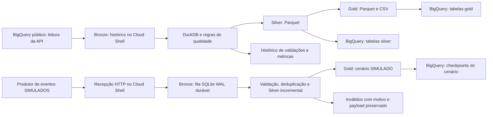

# Tech Challenge Fase 2: alfabetização no Brasil

**Batch e streaming simulado no Google Cloud Shell, com publicação no BigQuery gratuito e sem ativar faturamento.**

## Executar no Google Cloud

No Cloud Shell, dentro deste diretório:

```bash
gcloud services enable bigquery.googleapis.com cloudbilling.googleapis.com --project=postech-fase2-fulvius
bash src/run_cloudshell.sh postech-fase2-fulvius
```

O ID do projeto é argumento do script. A API de faturamento é usada somente para
confirmar que o projeto está **sem faturamento**; o código não vincula contas nem
ativa serviços pagos. Se essa confirmação falhar, a execução para.

O batch baixa as fontes e processa as camadas dentro do Cloud Shell. Bronze fica
no disco persistente; Silver e Gold também são carregadas no BigQuery por jobs de
carga batch, sem consultas SQL. Cada execução cria um dataset versionado com
prefixo `fase2_batch_`, inicialmente candidato. Só recebe o rótulo `published`
depois de concluir os jobs e conciliar as contagens. Nenhuma versão é sobrescrita.

As evidências ficam em `data/cloud_audit/`, os logs em `data/console/` e a última
publicação em `data/cloud_latest.json`. Faça backup de `data/`: o BigQuery gratuito
expira tabelas após 60 dias e o armazenamento persistente do Cloud Shell é limitado.
O empacotador `python src/package_cloudshell.py` gera `data/cloudshell_code.zip`
com código e referências necessárias, sem credenciais, ambiente Python ou alunos.
`python src/export_cloud_artifacts.py` gera um ZIP das camadas e evidências para
download e preservação independente dos prazos do ambiente gratuito.



Este é um ambiente de demonstração acadêmica com início manual. Agendamento
ainda está pendente. O Cloud Shell não é um
serviço para hospedar uma pipeline de produção continuamente.

Execução real de **26/10/2026**: 14 jobs de carga, 279.923.160 bytes lógicos
armazenados no BigQuery e 408,049 segundos de execução total, com faturamento
desativado antes e depois. Nenhum job de consulta SQL foi usado nesta publicação.
As 101 verificações incluem alertas conhecidos; as regras bloqueantes passaram.
Evidências: [jobs e métricas da nuvem](evidencias/execucao_batch_google_cloud.json)
e [validações do batch](evidencias/validacoes_batch_google_cloud.json).
O [teste de falha na nuvem](evidencias/falha_bloqueante_google_cloud.json) terminou
com erro esperado, sem novos jobs de carga e sem alterar as versões publicadas.
Os [resultados das regras nessa falha](evidencias/validacoes_falha_google_cloud.json)
também foram preservados.

[Abrir o dataset publicado no BigQuery](https://console.cloud.google.com/bigquery?project=postech-fase2-fulvius&p=postech-fase2-fulvius&d=fase2_batch_20261026t183455z_ef5d3e21&page=dataset).

## FinOps: medições e projeção mensal

Apuração em **26/10/2026**, em USD. **Custo do ambiente atual: US$ 0**, com
faturamento desativado, Cloud Shell gratuito, BigQuery sem faturamento e ntfy
gratuito. A [memória de cálculo e medição](evidencias/finops_medicoes.json) reúne
verificação atual das 26 tabelas por `tables.get`, estatísticas dos jobs, tamanho
dos backups e uso de disco do Cloud Shell; não é uma exportação de fatura.

As duas execuções bem-sucedidas consumiram 408,049 s + 52,939 s = **460,988 s**.
Foram **26 jobs LOAD e nenhum job QUERY** nessas publicações, com 59.603.355 bytes
Parquet enviados e **279.944.688 bytes lógicos (0,260719 GiB)** armazenados.
O preço do BigQuery usa o volume lógico, não o tamanho comprimido. O diretório
persistente do Cloud Shell usava 419.241.984 bytes, aproximadamente 400 MiB.
Consultas exploratórias e tempo de desenvolvimento/testes não integram esses totais.

Para a projeção, a cadência proposta é **1 batch completo + 1 demonstração finita
de 17 envios por mês**, com capacidade aproximada de duas versões mensais no
BigQuery durante a retenção de 60 dias. Isso é uma premissa de orçamento, não um
agendamento implementado ou streaming contínuo. Para tarifar o mesmo trabalho em
produção, considera-se apenas como hipótese uma VM `e2-standard-2` em `us-central1`
(2 vCPU/8 GiB), disco persistente padrão de 10 GiB e IPv4 efêmero. A VM e o IP
ficariam ativos durante o processamento; o disco permaneceria o mês inteiro.
**Nenhuma VM ou recurso pago foi criado.**

| Serviço | Unidade | Medição → quantidade mensal projetada | Preço unitário USD | Custo mensal USD, antes de franquias |
| --- | --- | --- | ---: | ---: |
| Executor hipotético e2-standard-2 | hora | 460,988 s → 0,128052 h | 0,06701142/h | 0,00858 |
| Disco persistente padrão | GiB-mês | ~0,390 GiB usados no ambiente → 10 GiB provisionados, premissa para sistema e histórico | 0,04 | 0,40000 |
| IPv4 efêmero em uso | hora | mesma janela da VM → 0,128052 h | 0,005/h | 0,00064 |
| BigQuery, armazenamento lógico ativo US | GiB-mês | 0,260719 GiB/versão → 0,521438 GiB-mês | ~0,023 | 0,01199 |
| BigQuery, cargas no pool compartilhado | job | 26 jobs → 26/mês | 0 | 0 |
| Saída dos backups para o Brasil, Premium Tier | GiB | 129.145.526 bytes → 0,120276 GiB/mês | 0,19 | 0,02285 |
| ntfy gratuito | mensagem | 2 testes entregues → orçamento de 2 avisos/mês, sem prever frequência de falhas | 0 | 0 |
| **Total hipotético** | | | | **~0,44/mês** |

Tarifas consultadas: [VM](https://cloud.google.com/products/compute/pricing/general-purpose?hl=en),
[disco](https://cloud.google.com/compute/disks-image-pricing),
[IP e rede](https://cloud.google.com/vpc/pricing),
[BigQuery](https://cloud.google.com/bigquery/pricing),
[cargas gratuitas](https://docs.cloud.google.com/bigquery/docs/batch-loading-data) e
[Cloud Shell gratuito](https://cloud.google.com/shell/pricing). Valores de produção
sem descontos, impostos ou conversão cambial; o total não é cobrança realizada.
O tempo no Cloud Shell é referência para cálculo, não benchmark da VM. Boot,
instalação, novas falhas e overhead de rede não foram medidos nessa projeção.
O egress usa tamanhos reais dos backups, não medição de pacotes faturáveis ou
do tráfego de controle/notificações.

Controles implementados: verificação de faturamento desativado; leitura pública
por API sem jobs SQL; reprocessamento com `--bronze` sem nova extração; Bronze gzip,
Parquet ZSTD e limite DuckDB de 512 MB/2 threads; publicação com limite preventivo
de 1 GiB descomprimido no batch. Não há cópia das bases entre provedores de nuvem;
o backup para o computador foi considerado separadamente. Novas versões da fonte
geram novos snapshots e precisam de nova medição, sem assumir que o volume é fixo.
Os [limites gratuitos](https://docs.cloud.google.com/bigquery/docs/sandbox) incluem
expiração em 60 dias e quota de armazenamento de 10 GiB cumulativos, não recuperada
ao apagar tabelas. O histórico e a Gold da fase 3 estão em backups locais; não se
projeta crescimento ilimitado dentro do ambiente gratuito.

## Alertas de falha

Os comandos de batch local, ingestão, batch na GCP e streaming são monitorados.
Quando uma exceção encerra a execução, `alerts.py` persiste um incidente e envia
uma notificação pelo [ntfy gratuito](https://ntfy.sh/). Falhas conhecidas da fonte
registradas como alertas de qualidade, duplicados tratados e eventos já colocados
em quarentena não geram notificações de falha operacional.

A configuração já foi feita neste computador e no Cloud Shell. Para reproduzir
em outro ambiente, depois de configurar o Python:

```bash
python src/alerts.py setup --owner "Fulvius"
```

Abra o endereço impresso, inscreva-se no tópico e permita notificações no navegador
ou no aplicativo ntfy. O tópico aleatório fica em `data/alerts/config.json`, fora
do Git e do pacote de código. Em tópicos gratuitos o nome não é controle de acesso:
quem conhece o endereço pode ler ou publicar. As mensagens contêm apenas pipeline,
identificador da execução, horário, classe do erro e responsável, sem payloads de
alunos, credenciais, detalhes completos de exceção ou dados pessoais da base.

**Quem descobre e em quanto tempo:** Fulvius recebe o aviso no tópico inscrito
assim que uma exceção é detectada e o ntfy aceita o envio. Nos testes reais na GCP,
a aceitação levou 0,191 s para o streaming e 0,153 s para o batch. Esses tempos
medem detecção até confirmação do servidor, não leitura humana ou exibição no
aparelho. Recepção no dispositivo depende da conexão e das permissões locais.

O monitor registra início, término, duração e status em `data/monitor/`. O histórico
de notificações e tentativas fica em SQLite e em `data/alerts/delivery_history.json`.
O envio tem até três tentativas, com espera e timeouts de conexão/leitura. Um
incidente já confirmado não é reenviado; timeout após aceitação remota ainda pode
produzir duplicidade, pois não há transação distribuída com o provedor externo.
Se o envio falhar, permanece pendente e o erro original da pipeline é relançado,
mantendo código de saída diferente de zero. Para tentar novamente e exportar:

```bash
python src/alerts.py retry
python src/alerts.py export
```

Não há reenvio agendado. O monitor cobre exceções dos comandos enquanto o processo
Python está ativo; desligamento da máquina, execução que não chegou a iniciar e
encerramento forçado exigem monitor externo, ainda não implementado neste ambiente.

[Evidências dos dois alertas reais na GCP](evidencias/alertas_google_cloud.json) e
[histórico de entrega sem o endereço privado](evidencias/historico_alertas.json).
Os testes controlados provocaram uma falha bloqueante do batch e uma falha de
inicialização do streaming, confirmaram as mensagens pela API do ntfy e preservaram
as publicações anteriores. Avisos de demonstração usam `POSTECH_ALERT_TEST_MODE=1`;
as execuções normais não precisam dessa variável. O servidor confirmou os envios
e o usuário confirmou a visualização dos dois avisos no tópico. Isso não presume
que o navegador tenha exibido uma notificação do sistema operacional.

## Executar o streaming simulado

Depois de executar o batch, na mesma pasta do Cloud Shell:

```bash
bash src/run_streaming_cloudshell.sh postech-fase2-fulvius
```

Para testar localmente sem publicar: `python src/stream_demo.py` no ambiente
Python já configurado. A demonstração é finita e encerra os processos ao concluir.

O produtor envia JSON por HTTP para `/events`, em endereço de loopback com porta
temporária. Cada envio tem `event_id`, versão do contrato, tipo do evento, origem,
horário real de produção, ano, município, série, rede e taxa. O receptor só devolve
HTTP 202 depois de persistir o payload original, codificado reversivelmente em
Base64, e um horário próprio de recepção na fila SQLite com WAL e sincronização FULL.
A validação ocorre de forma assíncrona; HTTP 202 confirma recebimento, não aprovação.

O consumidor consulta **somente os pendentes**, em microlotes a cada 0,5 segundo.
O evento válido entra na Silver e atualiza o estado municipal do cenário. Registro
de evento, atualização de estado e confirmação de consumo usam a mesma transação:
uma falha antes do commit preserva o recebimento pendente para retomada.

- Mesmo ID e conteúdo: duplicado registrado, sem reaplicar o efeito.
- Mesmo ID com conteúdo diferente: quarentena por conflito.
- JSON, origem, recorte, território, horário ou percentual inválido: quarentena.
- Evento atrasado: preservado na Silver; o estado é escolhido por horário de
  produção, com desempate por ID. Não há descarte por janela nem watermark.
- Os únicos eventos aceitos têm `origem=SIMULADO`; não alteram a Gold oficial.

As garantias valem para a mesma fila persistente. O produtor demonstra reenvio
com ID estável; não há broker gerenciado, disponibilidade contínua ou promessa de
entrega durante indisponibilidade permanente. A perda do disco exige restauração
do backup, e consumidores dependem de reinício manual neste ambiente acadêmico.

| Aspecto | Batch | Streaming simulado |
| --- | --- | --- |
| Fonte | Tabelas oficiais completas | Eventos sintéticos recebidos por HTTP |
| Frequência | Execução manual por snapshot | Consumo periódico dos novos pendentes |
| Processamento | Reprocessa o snapshot escolhido | Atualiza somente os municípios dos eventos novos |
| Garantias | Integridade do snapshot e bloqueio antes da promoção | Recebimento durável, transação e deduplicação por ID |
| Latência | Duração da extração e transformação | Produção até recepção e produção até processamento, medidas separadamente |

O streaming acontece no receptor e no consumidor. Como o [BigQuery sem faturamento
não aceita inserção streaming nativa](https://docs.cloud.google.com/bigquery/docs/sandbox),
os resultados são publicados por **jobs de carga batch gratuitos** em dois
checkpoints, `c01` e `c02`. Essas cargas não são apresentadas como streaming nativo
do BigQuery. A latência do consumidor não inclui a espera pelos jobs de publicação;
os tempos desses jobs também ficam registrados na auditoria.

Cada checkpoint tem Bronze, Silver, destinos, quarentena, métricas dos microlotes
e Gold, em CSV/Parquet e tabelas BigQuery com sufixo correspondente. A versão
anterior permanece disponível. O rótulo `checkpoint` do dataset e o arquivo
`data/streaming_latest.json` só avançam depois da conciliação de todas as contagens.
As junções da Gold são verificadas contra o número de estados municipais esperados.

A [execução real de streaming de 26/10/2026](evidencias/execucao_streaming_google_cloud.json)
registrou 17 recebimentos: 6 eventos únicos aceitos, 2 duplicados e 9 inválidos
propositais em quarentena, sem pendências; três microlotes e 12 jobs de carga.
As duas versões mostram Belo Horizonte e Uberlândia com valores simulados; seus
resultados oficiais são mantidos como referência em colunas separadas.
Também foram demonstradas falha antes do commit, recuperação após reinício,
reexecução sem novos efeitos e chegada fora de ordem. A latência média de recepção
foi 46,34 ms e a média até processamento, 328,66 ms, nesta demonstração pequena.
Esses números não são uma medição de capacidade ou garantia de produção.

[Abrir os checkpoints de streaming no BigQuery](https://console.cloud.google.com/bigquery?project=postech-fase2-fulvius&p=postech-fase2-fulvius&d=fase2_stream_20261026t185721z_76d716b6&page=dataset).

Fila, snapshots e auditoria ficam em `data/streaming/ID_DA_EXECUCAO/`. Para preservar
a demonstração: `python src/export_cloud_artifacts.py --streaming`. O ZIP gerado
inclui a fila e os checkpoints. As tabelas do ambiente gratuito expiram em 60 dias.

## Executar o batch

Requer Python 3.12+ e o login ADC já configurado neste computador.

```powershell
python -m venv .venv
.venv\Scripts\python -m pip install -r requirements.txt
.venv\Scripts\python src/batch.py
```

O comando lê as tabelas públicas pela API de leitura (sem jobs SQL), preserva
Bronze comprimida, gera Silver/Gold locais em Parquet e valida antes de publicar.
O arquivo `data/latest.json` aponta para a última execução aprovada; os dados e
credenciais não são versionados. O histórico de validações fica em `data/audit/`.
Para reprocessar sem baixar novamente:

```powershell
.venv\Scripts\python src/batch.py --bronze data/bronze/ID_DO_SNAPSHOT
```

`--inject-failure` permite demonstrar uma falha bloqueante antes da publicação.
O streaming simulado tem execução e publicação próprias, descritas acima.

Este diretório reúne as descobertas, consultas e evidências da investigação do
dataset `basedosdados.br_inep_avaliacao_alfabetizacao`. O projeto já executa batch
e streaming simulado, com Bronze, Silver e Gold e evidências reais em nuvem.
Métricas, alertas de falha e FinOps estão registrados no escopo descrito acima.
A Gold deverá ser preservada para
a fase 3.

Registro consolidado em **21/10/2026**. Os números representam o estado consultado
da fonte nessa investigação, não uma garantia de que consultas futuras retornarão
os mesmos valores.

## Por onde começar

1. [Inventário e acesso](docs/01_inventario_e_acesso.md): fontes, volumes, recortes e autenticação.
2. [Resultados da investigação](docs/02_investigacao_metas_2024.md): junção, 216 exceções e comparação dos 70 casos com o Inep.
3. [Plano e requisitos](docs/03_plano_e_requisitos.md): próximos passos e checklist do enunciado.
4. [Enunciado original](referencias/enunciado_fase_2.pdf).
5. [Manifesto das fontes](referencias/manifesto.json): URLs, arquivos, tamanhos e SHA-256.
6. [Desenho proposto da base analítica](docs/04_desenho_base_analitica.md): tabelas, junções e decisões abertas.
7. [Decisões de rede, território e fonte](docs/05_decisoes_redes_territorio_fontes.md): regras fechadas e evidências.
8. [Alunos, pesos e recálculo](docs/06_elegibilidade_pesos_recalculo.md): regra de elegibilidade, fórmula e limites de reprodução.
9. [Catálogo de qualidade](docs/07_catalogo_qualidade.md): bloqueios, alertas, exceções e registro das divergências.

## O que já foi verificado

- Projeto Google Cloud: `postech-fase2-fulvius`.
- BigQuery API habilitada e acesso pelo computador testado.
- Sete tabelas acessíveis: seis entidades obrigatórias e dicionário.
- Resultados municipais de 2024 comparados com metas da **rede municipal**.
- 5.448 resultados, 5.352 correspondências e 5.232 comparações possíveis.
- 96 municípios sem registro de meta e 120 com meta de 2024 ausente.
- Entre os 120, 70 têm resultado de 2023 em `municipio`, mas não na publicação de
  resultados e metas. As duas planilhas originais confirmam a diferença.
- Meta pactuada e cenário aspiracional são conceitos separados: a coluna nacional
  de 2030 para a rede Pública contém 80; universalização é a aspiração de 100%.

## Consultas para repetir a investigação

Abra os arquivos abaixo no editor SQL do BigQuery, com o projeto
`postech-fase2-fulvius` selecionado. São consultas de leitura, sem criação de tabelas.

| Arquivo | Objetivo |
| --- | --- |
| [01_inventario.sql](sql/01_inventario.sql) | Contagens e tamanhos nos metadados |
| [02_cobertura.sql](sql/02_cobertura.sql) | Anos, séries, redes e volumes de resultados |
| [03_resultados_municipais_metas_2024.sql](sql/03_resultados_municipais_metas_2024.sql) | Comparação por município, preservando ausências |
| [04_investigar_excecoes.sql](sql/04_investigar_excecoes.sql) | Detalhar os 216 casos e o resultado de 2023 |
| [05_metricas_da_juncao.sql](sql/05_metricas_da_juncao.sql) | Correspondência, preenchimento e cumprimento |
| [06_dicionario.sql](sql/06_dicionario.sql) | Interpretar códigos oficiais |
| [07_unicidade_das_chaves.sql](sql/07_unicidade_das_chaves.sql) | Detectar chaves repetidas antes de juntar |
| [08_contexto_metas_uf_brasil.sql](sql/08_contexto_metas_uf_brasil.sql) | Conferir anos, rede Pública e mudanças de metas históricas entre linhas |
| [09_codigos_territoriais_por_ano.sql](sql/09_codigos_territoriais_por_ano.sql) | Códigos distintos para conferir contra a DTB do respectivo ano |
| [10_perfil_alunos.sql](sql/10_perfil_alunos.sql) | Presença, preenchimento, pesos e corte de proficiência |
| [11_recalculo_municipal.sql](sql/11_recalculo_municipal.sql) | Taxa ponderada municipal e comparação entre fontes |
| [12_recalculo_publico_uf_brasil.sql](sql/12_recalculo_publico_uf_brasil.sql) | Agregação dos alunos públicos elegíveis por UF e no conjunto disponível |
| [13_chaves_e_excluidos_alunos.sql](sql/13_chaves_e_excluidos_alunos.sql) | Chave candidata e classificação nos registros excluídos |

O usuário informou ter salvo `03_resultados_municipais_metas_2024` no BigQuery
Studio. Este diretório guarda uma versão SQL com a mesma lógica; a consulta salva
não foi inspecionada por API para confirmar igualdade de conteúdo.

**Sandbox** é o modo de utilização do BigQuery. A consulta salva é um recurso do
projeto, contendo SQL; ela não é uma cópia dos resultados nem uma camada Bronze.

## Evidências locais

- [Planilha original de 2023](referencias/inep_resultados_e_metas_municipios_2023.xlsx).
- [Planilha original de 2024](referencias/inep_resultados_e_metas_municipios_2024.xlsx).
- [Comparação dos 70 municípios](evidencias/comparacao_70_municipios.csv).
- [Resumo da conferência](evidencias/resumo_conferencia.json).
- [Métricas retornadas pela consulta da junção](evidencias/metricas_juncao_2024.json).
- [Contexto consultado das metas de UF e Brasil](evidencias/contexto_metas_uf_brasil.json).
- [Conferência de rede, território e fontes originais](evidencias/decisoes_rede_territorio_fontes.json).
- [Resumo do recálculo ponderado](evidencias/resumo_recalculo_alunos.json).
- [Conferência municipal dos alunos](evidencias/recalculo_municipal_alunos.csv).

Os originais foram copiados sem alterações. Esses arquivos e consultas são material
de pesquisa, não representam ingestão, tratamento ou execução da futura pipeline.
Nenhuma credencial deve ser versionada.

## Verificação deste registro

- Sete SQLs validados por dry run no BigQuery.
- Consulta `05_metricas_da_juncao.sql` executada novamente e contagens confirmadas.
- Os 70 casos conferidos contra os dois originais, incluindo metas de 2025 e 2030.
- SHA-256 das três referências e links locais da documentação conferidos.

Essas verificações validam o material de investigação; não são testes da futura pipeline.

## Próximo passo

Executar e verificar o batch local; depois avançar na simulação de eventos e na
demonstração possível no BigQuery Sandbox, sem serviços pagos.
