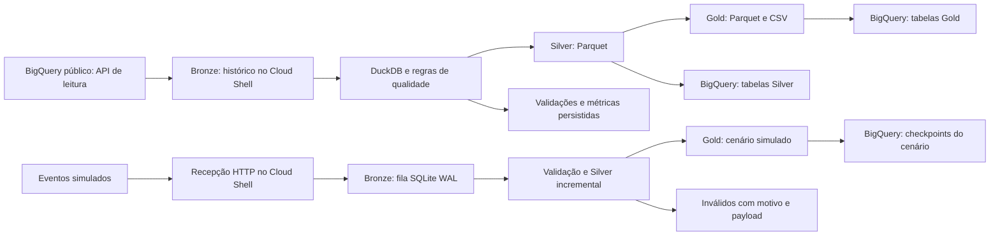

# Tech Challenge Fase 2: pipeline híbrida de alfabetização no Brasil

Projeto de engenharia de dados para acompanhar o Indicador Criança Alfabetizada,
integrar resultados e metas educacionais e disponibilizar uma base analítica
confiável. A solução executa batch e streaming simulado no Google Cloud, com
camadas Bronze, Silver e Gold, validações bloqueantes, métricas persistidas e
alertas de falha. O ambiente acadêmico funciona com faturamento desativado.

**Apresentação:** [PowerPoint com roteiro nas notas do apresentador](presentation/tech_challenge_alfabetizacao_fase_2.pptx).
**Vídeo executivo:** gravação ainda não publicada.

## 1. Contexto e definição do problema

O indicador mede a proporção de estudantes alfabetizados ao final do 2º ano do
ensino fundamental. Nos microdados, o ponto de corte é de 743 pontos de
proficiência. O projeto organiza as fontes para comparar resultados com metas,
identificar lacunas e apoiar análises de desigualdade educacional.

O acompanhamento principal usa resultados municipais de 2024 e a meta do mesmo
ano, território e rede. A meta pactuada nacional para 2030 é 80. A universalização
de 100% é um cenário aspiracional distinto. A trajetória de metas não representa
uma previsão produzida pelo projeto.

Referência dos requisitos: [enunciado do desafio](referencias/enunciado_fase_2.pdf).

## 2. Inventário das fontes e escolha de acesso

Investigamos as sete tabelas do dataset público
`basedosdados.br_inep_avaliacao_alfabetizacao`, incluindo as seis entidades
obrigatórias e o dicionário oficial.

| Fonte | Utilização na solução |
| --- | --- |
| `municipio` | Resultados por município, ano, série e rede |
| `uf` | Conferência dos resultados estaduais agregados |
| `alunos` | Recálculo ponderado e confronto com os agregados publicados |
| `meta_alfabetizacao_municipio` | Resultado divulgado, metas municipais e comparação oficial |
| `meta_alfabetizacao_uf` | Acompanhamento das metas estaduais |
| `meta_alfabetizacao_brasil` | Acompanhamento nacional e trajetória pactuada |
| `dicionario` | Interpretação e validação dos códigos categóricos |

Escolhemos a API REST do BigQuery, com `tables.get` e `tabledata.list`, para baixar
as tabelas completas sem jobs de consulta SQL. O volume cabe no ambiente gratuito
e permite processamento local com histórico reproduzível. A leitura preserva
metadados, contagens, SHA-256 e identificadores das extrações. Se a fonte mudar
durante a paginação ou o download ficar incompleto, a extração falha.

As consultas de investigação ficam em [sql/](sql/), e os originais do Inep e do
IBGE ficam em [referencias/](referencias/), identificados no
[manifesto das fontes](referencias/manifesto.json). A cópia de uma consulta salva
no BigQuery contém o SQL, enquanto as camadas da pipeline preservam os dados.

## 3. Investigação dos resultados e das lacunas

A junção municipal de 2024 identificou 5.448 resultados e 5.352 correspondências
de meta. Destes, 120 registros não têm valor de meta para 2024. Outros 96
municípios não têm registro de meta, totalizando **216 casos sem comparação**.

Entre os 120, 70 têm resultado de 2023 na tabela de agregados, mas não na
publicação de resultados e metas. Conferimos os casos nas planilhas originais
do Inep e preservamos a ausência. Ela não vira zero nem classificação de baixo
desempenho. As exceções são reconhecidas pelas chaves, não apenas por uma contagem.

Evidências: [investigação da junção](docs/02_investigacao_metas_2024.md),
[conferência dos 70 municípios](evidencias/comparacao_70_municipios.csv) e
[resumo da conferência](evidencias/resumo_conferencia.json).

## 4. Decisões de rede, território, fonte e pesos

- **Rede:** o acompanhamento municipal usa a rede Municipal. No contexto
  investigado, a rede Pública das metas estaduais corresponde ao agregado
  Estadual e Municipal, código 5. O código 6 inclui a rede Federal e mantém
  significado distinto. Os códigos vêm do dicionário oficial.
- **Território:** a dimensão usa a Divisão Territorial Brasileira do IBGE de cada
  ano. A conferência territorial encontrou correspondência para todos os códigos
  das fontes investigadas, sem projetar uma geografia futura de 2030.
- **Precedência:** o cumprimento da meta usa o resultado da própria publicação de
  resultados e metas, conferido contra o original. Os agregados dos microdados e o
  recálculo ficam ao lado para conferência, sem substituir o indicador divulgado.
- **Contexto temporal:** a comparação de 2024 usa a publicação de referência 2024.
  Uma linha posterior não sobrescreve o passado. O Brasil mantém meta de 59,9
  para esse recorte, mesmo havendo outro contexto com valor 60,0.
- **Precisão:** a referência original preserva o texto, o operador e as casas
  decimais. A escrita original `> 80` permanece identificável; o número 80 da Base
  dos Dados é a referência normalizada para distância numérica.
- **Alunos elegíveis:** presença e caderno preenchido, classificação binária,
  proficiência finita e peso positivo e finito. A taxa é
  `100 × soma dos pesos dos alfabetizados / soma dos pesos dos avaliados`.

O recálculo é uma conferência adicional. Quando diverge, mantemos os dois valores,
a diferença e o status `CALCULADO_NAO_HOMOLOGADO`. Cobertura incompleta e ausência
de avaliações elegíveis permanecem explícitas. A média simples dos municípios
não substitui o indicador nacional.

Detalhes: [redes, território e fontes](docs/05_decisoes_redes_territorio_fontes.md)
e [elegibilidade e pesos](docs/06_elegibilidade_pesos_recalculo.md).

## 5. Construção do batch e das camadas

Implementamos primeiro o processamento completo das sete tabelas. A carga de
alunos contém **3.867.999 registros**, antes dos filtros de elegibilidade.
Python organiza a execução e DuckDB realiza as transformações SQL com limite de
512 MB e duas threads. Gzip e Parquet com ZSTD reduzem o armazenamento e a transferência.

| Camada | Conteúdo e política |
| --- | --- |
| Bronze | CSV comprimido, metadados, manifesto, contagens e hashes por execução. Uma extração não sobrescreve a anterior |
| Silver | Tipos padronizados, chaves e domínios validados, território por ano, metas anuais e referência original |
| Gold | Comparação municipal, estadual e nacional, além da conferência ponderada dos alunos, em CSV e Parquet |

A Gold contém `comparacao_municipal_2024` com 5.448 linhas,
`comparacao_uf_2024` com 27, `comparacao_brasil_2024` com uma e
`conferencia_alunos` com 10.899 combinações de ano e município. O arquivo
`data/latest.json` aponta para a versão aprovada. O histórico continua disponível.

## 6. Qualidade e bloqueio de publicação

O catálogo distingue regras bloqueantes e informativas. Chaves obrigatórias,
duplicidade, domínios, percentuais, elegibilidade, classificação pelo corte e
consistência com a publicação original têm verificações automáticas.

As **12 métricas de junção** do batch registram entradas, correspondências,
ausências, cardinalidade, taxa bruta e limiar. Território e originais exigem 100%
dos pares esperados. A junção municipal permite somente os 96 códigos sem
registro confirmados na fonte, com correspondência bruta de 98,24%. Os 120 valores
de meta ausentes recebem controle separado. No agregado público de UF/2024,
série 2/rede 5, DF e RR não têm linha no snapshot verificado; outras ausências
bloqueiam. A cobertura da conferência ponderada depende dos alunos elegíveis e
dos agregados disponíveis, com os dois lados sem par preservados.

A versão revisada executa **116 verificações**. Uma falha bloqueante interrompe
a execução antes da promoção, persiste o motivo e termina com erro. As ausências
conhecidas e divergências descritivas geram alertas, mantendo seu significado.
Demonstramos uma falha real e verificamos que a versão válida anterior permaneceu
intacta. O catálogo completo é uma referência de contrato, com escopo e exceções
descritos em [docs/07_catalogo_qualidade.md](docs/07_catalogo_qualidade.md).

## 7. Execução no Google Cloud

Levamos o batch ao Cloud Shell e publicamos Silver e Gold no BigQuery gratuito.
Os jobs de carga usam o pool compartilhado e `WRITE_EMPTY` em um dataset novo por
execução, com prefixo `fase2_batch_`. A versão começa como candidata e recebe o
rótulo `published` somente após a conclusão dos jobs e a conciliação das contagens.
O arquivo `data/cloud_latest.json` registra a publicação aprovada.

As 14 tabelas publicadas correspondem a dez tabelas Silver e quatro Gold. A Bronze
permanece no disco persistente do Cloud Shell e nos backups. Mantemos a Gold
preservada para a fase 3, independentemente da expiração das tabelas gratuitas.



Evidências: [execução batch na GCP](evidencias/execucao_batch_google_cloud.json),
[validações da execução original](evidencias/validacoes_batch_google_cloud.json)
e [prova de falha bloqueante](evidencias/falha_bloqueante_google_cloud.json).
As contagens das auditorias pertencem às suas versões; a revisão final acrescentou
regras e métricas sem alterar os resultados oficiais.

## 8. Streaming simulado e processamento incremental

Implementamos um produtor que envia JSON para `/events`, em HTTP de loopback com
porta temporária. Cada evento identifica seu ID, versão, tipo, origem, horário
real de produção, ano, município, série, rede e taxa. O receptor confirma HTTP 202
somente depois de persistir o payload original em Base64 e um horário próprio de
recepção na fila SQLite, com WAL e sincronização FULL. O 202 confirma recebimento,
enquanto a validação ocorre de forma assíncrona.

O consumidor lê somente os pendentes, em microlotes a cada 0,5 segundo. Registro
na Silver, atualização do estado municipal e confirmação de consumo usam uma
transação. Uma falha antes do commit preserva o recebimento para retomada.

- Mesmo ID e conteúdo: duplicado registrado, sem reaplicar o efeito.
- Mesmo ID com conteúdo diferente: quarentena por conflito.
- JSON, origem, recorte, território, horário ou percentual inválido: quarentena.
- Evento atrasado: permanece na Silver. O estado usa o horário de produção e
  desempate por ID, preservando o resultado mais recente.
- Os eventos aceitos têm `origem=SIMULADO` e não alteram a Gold oficial.

A demonstração produziu **17 envios: 6 eventos únicos válidos, 2 duplicados e
9 inválidos propositais**, com todos os destinos contabilizados e nenhuma
pendência. Três microlotes alimentaram dois checkpoints. Belo Horizonte passou de
60 para 65 no cenário, e Uberlândia de 70 para 75, com os resultados oficiais em
colunas separadas. Foram 12 jobs de carga para as duas versões das seis tabelas.

| Aspecto | Batch | Streaming simulado |
| --- | --- | --- |
| Fonte | Tabelas oficiais completas | Eventos sintéticos recebidos por HTTP |
| Consumo | Snapshot escolhido por execução | Novos recebimentos pendentes em microlotes |
| Garantias | Integridade da extração e bloqueio antes da promoção | Recebimento durável, transação e deduplicação por ID |
| Latência | Duração das etapas do processamento completo | Produção até recepção e produção até processamento |

A latência média da demonstração foi 46,34 ms até recepção e 328,66 ms até
processamento. Os carimbos de produção e recepção são distintos. Os tempos dos
jobs de publicação ficam separados desses valores. O [BigQuery sem faturamento](https://docs.cloud.google.com/bigquery/docs/sandbox)
não aceita inserção streaming nativa: o streaming ocorre no receptor e no
consumidor, e os checkpoints chegam ao BigQuery por cargas batch gratuitas.

Os arquivos ficam em `data/streaming/ID_DA_EXECUCAO/`. Cada checkpoint preserva
Bronze, Silver, destinos, quarentena, métricas e Gold. O rótulo do dataset e
`data/streaming_latest.json` só avançam depois da conciliação das contagens.
Demonstramos recuperação após falha, reexecução sem novos efeitos e chegada fora
de ordem. Evidência: [auditoria do streaming](evidencias/execucao_streaming_google_cloud.json).

## 9. Monitoramento e notificações de falha

Os comandos de ingestão, batch local, batch na GCP e streaming registram início,
término, duração e status em `data/monitor/`. O batch também persiste duração e
contagens das quatro etapas: obter Bronze, tipar e validar Silver, integrar e
validar Gold e exportar os arquivos. Validações, contagens, tempos dos jobs e
métricas dos microlotes sobrevivem ao encerramento dos processos.

Exceções que encerram a pipeline geram um incidente e uma notificação pelo
[ntfy gratuito](https://ntfy.sh/). Fulvius recebe o aviso no tópico inscrito.
Nos testes reais, o servidor aceitou o alerta do streaming em 0,191 s e o do
batch em 0,153 s após a detecção. O usuário confirmou a visualização dos dois.
Esses tempos não medem leitura humana nem garantem notificação do sistema
operacional, que depende de conexão e permissões do dispositivo.

A fila de avisos e o histórico de tentativas ficam em `data/alerts/`. Cada envio
tem até três tentativas, com espera e timeouts. Um incidente já confirmado não é
reenviado. Em indisponibilidade, fica pendente para reenvio e a pipeline continua
marcada como falha, com código de saída diferente de zero. Timeout após aceitação
remota ainda pode gerar aviso duplicado. Alertas informativos dos dados e eventos
já tratados em quarentena não disparam uma falha operacional.

O tópico aleatório fica em `data/alerts/config.json`, fora do Git e do pacote de
código. Em tópicos gratuitos, quem conhece o endereço pode ler ou publicar.
Enviamos somente resumo da execução, sem dados de alunos, credenciais ou detalhes
completos da exceção. Evidências: [alertas confirmados](evidencias/alertas_google_cloud.json)
e [histórico de entrega](evidencias/historico_alertas.json).

## 10. FinOps: medições e controle de custos

Valores em USD, com fontes e data de consulta preservadas na memória de cálculo. **Custo do ambiente atual: US$ 0**, com
faturamento desativado, Cloud Shell gratuito, BigQuery sem faturamento e ntfy
gratuito. A [memória de cálculo e medição](evidencias/finops_medicoes.json) reúne
verificação atual das 26 tabelas por `tables.get`, estatísticas dos jobs, tamanho
dos backups e uso de disco do Cloud Shell; não é uma exportação de fatura.

As duas execuções bem-sucedidas consumiram 408,049 s + 52,939 s = **460,988 s**.
Foram **26 jobs LOAD e nenhum job QUERY** nessas publicações, com 59.603.355 bytes
Parquet enviados e **279.944.688 bytes lógicos (0,260719 GiB)** armazenados.
O preço do BigQuery usa o volume lógico, não o tamanho comprimido. O diretório
persistente do Cloud Shell usava 419.241.984 bytes, aproximadamente 400 MiB.
Consultas exploratórias e tempo de desenvolvimento/testes não integram esses totais.

Para a projeção, a cadência proposta é **1 batch completo + 1 demonstração finita
de 17 envios por mês**, com capacidade aproximada de duas versões mensais no
BigQuery durante a retenção de 60 dias. Isso é uma premissa de orçamento, não um
agendamento implementado ou streaming contínuo. Para tarifar o mesmo trabalho em
produção, considera-se apenas como hipótese uma VM `e2-standard-2` em `us-central1`
(2 vCPU/8 GiB), disco persistente padrão de 10 GiB e IPv4 efêmero. A VM e o IP
ficariam ativos durante o processamento; o disco permaneceria o mês inteiro.
**Nenhuma VM ou recurso pago foi criado.**

| Serviço | Unidade | Medição → quantidade mensal projetada | Preço unitário USD | Custo mensal USD, antes de franquias |
| --- | --- | --- | ---: | ---: |
| Executor hipotético e2-standard-2 | hora | 460,988 s → 0,128052 h | 0,06701142/h | 0,00858 |
| Disco persistente padrão | GiB-mês | ~0,390 GiB usados no ambiente → 10 GiB provisionados, premissa para sistema e histórico | 0,04 | 0,40000 |
| IPv4 efêmero em uso | hora | mesma janela da VM → 0,128052 h | 0,005/h | 0,00064 |
| BigQuery, armazenamento lógico ativo US | GiB-mês | 0,260719 GiB/versão → 0,521438 GiB-mês | ~0,023 | 0,01199 |
| BigQuery, cargas no pool compartilhado | job | 26 jobs → 26/mês | 0 | 0 |
| Saída dos backups para o Brasil, Premium Tier | GiB | 129.145.526 bytes → 0,120276 GiB/mês | 0,19 | 0,02285 |
| ntfy gratuito | mensagem | 2 testes entregues → orçamento de 2 avisos/mês, sem prever frequência de falhas | 0 | 0 |
| **Total hipotético** | | | | **~0,44/mês** |

Tarifas consultadas: [VM](https://cloud.google.com/products/compute/pricing/general-purpose?hl=en),
[disco](https://cloud.google.com/compute/disks-image-pricing),
[IP e rede](https://cloud.google.com/vpc/pricing),
[BigQuery](https://cloud.google.com/bigquery/pricing),
[cargas gratuitas](https://docs.cloud.google.com/bigquery/docs/batch-loading-data) e
[Cloud Shell gratuito](https://cloud.google.com/shell/pricing). Valores de produção
sem descontos, impostos ou conversão cambial; o total não é cobrança realizada.
O tempo no Cloud Shell é referência para cálculo, não benchmark da VM. Boot,
instalação, novas falhas e overhead de rede não foram medidos nessa projeção.
O egress usa tamanhos reais dos backups, não medição de pacotes faturáveis ou
do tráfego de controle/notificações.

Controles implementados: verificação de faturamento desativado; leitura pública
por API sem jobs SQL; reprocessamento com `--bronze` sem nova extração; Bronze gzip,
Parquet ZSTD e limite DuckDB de 512 MB/2 threads; publicação com limite preventivo
de 1 GiB descomprimido no batch. Não há cópia das bases entre provedores de nuvem;
o backup para o computador foi considerado separadamente. Novas versões da fonte
geram novos snapshots e precisam de nova medição, sem assumir que o volume é fixo.
Os [limites gratuitos](https://docs.cloud.google.com/bigquery/docs/sandbox) incluem
expiração em 60 dias e quota de armazenamento de 10 GiB cumulativos, não recuperada
ao apagar tabelas. O histórico e a Gold da fase 3 estão em backups locais; não se
projeta crescimento ilimitado dentro do ambiente gratuito.

## 11. Revisão do enunciado e reprodução em clone limpo

Revisamos a solução contra o PDF e completamos métricas de correspondência após
as junções e duração por etapa. Um snapshot Git temporário da versão candidata
originou um clone novo no Cloud Shell, inicialmente sem `data/`, sem `.venv/` e
com a árvore Git limpa. A autenticação Google autorizada foi o pré-requisito
externo. Nenhum dado ou ambiente Python anterior foi copiado para o teste.

O clone baixou novamente as sete tabelas, instalou as dependências, passou em
**25 testes automatizados**, executou batch e streaming e publicou 26 tabelas na
GCP. A verificação de dependências não encontrou conflitos. A falha bloqueante
terminou com código 1 e preservou os três ponteiros de publicação. A árvore Git
terminou limpa. Os originais mantiveram os hashes e os links locais foram conferidos.

O tópico privado do ntfy não foi copiado para o clone. O teste de falha registrou
`UNCONFIGURED`, como previsto sem destino externo. As notificações reais foram
comprovadas separadamente. O [relatório de reprodução](evidencias/reprodutibilidade_clone_limpo.json)
preserva comandos, resultados, métricas e os 26 identificadores reais de jobs.

## 12. Resultados analíticos e uso na fase 3

| Resultado municipal de 2024 | Municípios |
| --- | ---: |
| Atingiram a meta | 2.788 |
| Não atingiram | 2.444 |
| Meta de 2024 ausente no registro | 120 |
| Sem registro de meta | 96 |
| **Total** | **5.448** |

São **5.232 comparações possíveis**. No Brasil, o resultado publicado de 59,2 fica
0,7 ponto percentual abaixo da meta de 59,9. As limitações das fontes permanecem
identificadas, com os resultados oficiais como referência e a conferência dos
microdados separada. A investigação necessária ao recorte desta fase está consolidada.

A Gold pode apoiar modelos de desempenho municipal e análises de desigualdade.
Para prever resultado de 2024, os preditores devem estar disponíveis antes desse
resultado, como o histórico de 2023. A validação deve respeitar o tempo e a
cobertura. O próprio resultado, seu recálculo, saldo e status de cumprimento
revelam o alvo e ficam fora dos preditores. Metas e revisões posteriores ao
instante da previsão também precisam ser excluídas.

Não treinamos modelo preditivo nesta fase. Dois anos e a cobertura incompleta dos
microdados não sustentam uma previsão robusta até 2030. Eventos simulados servem
à demonstração de engenharia e ficam fora do treinamento com dados oficiais.
Os backups preservam a Gold para a fase 3.

## Apresentação executiva

O [PowerPoint](presentation/tech_challenge_alfabetizacao_fase_2.pptx) apresenta o
problema, a investigação, os resultados, a arquitetura, a qualidade, o streaming,
os alertas, os custos e a reprodução. O roteiro está nas **notas de cada slide**,
visível no Modo do Apresentador. A leitura foi dimensionada para aproximadamente
quatro a cinco minutos, com o integrante apresentando o projeto.

O roteiro e os números usam as evidências do repositório. A publicação da gravação
do vídeo executivo ainda não foi informada.

## Como reproduzir a solução

Pré-requisitos: Git, Python **3.12**, internet e conta Google com acesso a um
projeto próprio sem faturamento. A autenticação é externa ao clone e nenhuma
credencial deve ser versionada. O código recebe o ID do projeto por argumento.

```bash
git clone https://github.com/fulvius10/POSTECH_AI_SCIENTIST-main.git
cd POSTECH_AI_SCIENTIST-main/tech_challenge_fase_2_alfabetizacao
```

### Google Cloud Shell

Autorize o acesso à conta quando solicitado e substitua o ID de exemplo pelo seu:

```bash
gcloud services enable bigquery.googleapis.com cloudbilling.googleapis.com --project=postech-fase2-fulvius
bash src/run_cloudshell.sh postech-fase2-fulvius
.venv/bin/python -m unittest discover -s tests -v
bash src/run_streaming_cloudshell.sh postech-fase2-fulvius
```

O bootstrap instala as versões de `requirements.txt` num ambiente Python próprio.
A API de faturamento é usada apenas para confirmar que o faturamento está
desativado. O código não vincula conta de cobrança e interrompe esse caminho se
a confirmação falhar. Os links de console dependem de acesso ao projeto;
as evidências versionadas permitem examinar a execução sem compartilhar credenciais.

### Execução local no Windows

Com a Google Cloud CLI instalada e o projeto gratuito preparado:

```powershell
gcloud auth application-default login
gcloud auth application-default set-quota-project SEU_ID_DE_PROJETO
python -m venv .venv
.venv\Scripts\python -m pip install -r requirements.txt
.venv\Scripts\python -m unittest discover -s tests -v
.venv\Scripts\python src/batch.py
.venv\Scripts\python src/stream_demo.py
```

Os testes não precisam de conta Google, dados baixados nem notificações reais.
A execução completa do batch precisa de autenticação. O streaming local usa a
Gold recém-gerada pelo batch e executa a demonstração sem publicar no BigQuery.
Para reprocessar um snapshot sem baixar novamente:

```powershell
.venv\Scripts\python src/batch.py --bronze data/bronze/ID_DO_SNAPSHOT
```

`--inject-failure` demonstra um bloqueio antes da publicação, com erro esperado.

### Configuração dos alertas

Depois de instalar as dependências, execute no ambiente Python configurado:

```bash
python src/alerts.py setup --owner "Fulvius"
```

Abra o endereço impresso, inscreva-se no tópico e permita as notificações no
navegador ou no aplicativo ntfy. Para receber avisos desde a primeira execução,
configure o canal antes de iniciar a pipeline. Para reenviar pendentes e exportar
o histórico:

```bash
python src/alerts.py retry
python src/alerts.py export
```

No Cloud Shell, use `.venv/bin/python`; no Windows, `.venv\Scripts\python`.
Avisos de demonstração usam `POSTECH_ALERT_TEST_MODE=1`. Os comandos normais
funcionam sem essa variável.

### Backups e estrutura dos artefatos

```bash
python src/export_cloud_artifacts.py
python src/export_cloud_artifacts.py --streaming
```

O primeiro comando gera um ZIP das camadas e evidências do ambiente. O segundo
preserva a demonstração de streaming com fila, referência oficial e checkpoints.
O histórico exportável de alertas não contém o tópico privado de configuração.
`python src/package_cloudshell.py` empacota código e referências para upload,
sem credenciais, ambiente Python ou microdados de alunos.

```text
src/             Ingestão, batch, streaming, qualidade e alertas
tests/           Testes automatizados
sql/             Consultas da investigação
referencias/     Originais e manifesto de fontes
docs/            Decisões e investigação documentadas
evidencias/      Resultados e métricas versionáveis das execuções
presentation/    PowerPoint com notas do apresentador
data/            Camadas, filas, auditorias e backups locais, fora do Git
```

## Limitações do ambiente

O projeto é uma demonstração acadêmica com início manual. A simulação é finita e
encerra os processos ao concluir. As garantias de retomada valem para a mesma
fila persistente. A perda do disco exige restauração do backup. Não há broker
gerenciado, disponibilidade contínua, watermark ou agendamento implementado.

O monitor de falhas cobre exceções enquanto o processo Python está ativo.
Desligamento da máquina, execução que não chegou a iniciar e encerramento forçado
exigem monitor externo. O reenvio de avisos pendentes é manual. Infraestrutura
como código e monitoramento externo não integram esta implementação.

Tempos medidos em uma demonstração pequena não representam capacidade de produção
ou SLA. Divergências do recálculo não são homologadas automaticamente. A publicação
e a geografia são identificadas por contexto e ano para preservar a interpretação.

## Documentação e consultas da investigação

- [Inventário e acesso](docs/01_inventario_e_acesso.md).
- [Investigação das metas e exceções](docs/02_investigacao_metas_2024.md).
- [Registro inicial dos requisitos](docs/03_plano_e_requisitos.md).
- [Desenho da base analítica](docs/04_desenho_base_analitica.md).
- [Decisões de rede, território e fonte](docs/05_decisoes_redes_territorio_fontes.md).
- [Alunos, pesos e recálculo](docs/06_elegibilidade_pesos_recalculo.md).
- [Catálogo de qualidade](docs/07_catalogo_qualidade.md).

As consultas abaixo reproduzem a investigação com o projeto selecionado no BigQuery:

| Arquivo | Objetivo |
| --- | --- |
| [01_inventario.sql](sql/01_inventario.sql) | Contagens e tamanhos nos metadados |
| [02_cobertura.sql](sql/02_cobertura.sql) | Anos, séries, redes e volumes de resultados |
| [03_resultados_municipais_metas_2024.sql](sql/03_resultados_municipais_metas_2024.sql) | Comparação por município, preservando ausências |
| [04_investigar_excecoes.sql](sql/04_investigar_excecoes.sql) | Detalhar os 216 casos e o resultado de 2023 |
| [05_metricas_da_juncao.sql](sql/05_metricas_da_juncao.sql) | Correspondência, preenchimento e cumprimento |
| [06_dicionario.sql](sql/06_dicionario.sql) | Interpretar códigos oficiais |
| [07_unicidade_das_chaves.sql](sql/07_unicidade_das_chaves.sql) | Detectar chaves repetidas antes de juntar |
| [08_contexto_metas_uf_brasil.sql](sql/08_contexto_metas_uf_brasil.sql) | Conferir anos, rede Pública e mudanças de metas históricas entre linhas |
| [09_codigos_territoriais_por_ano.sql](sql/09_codigos_territoriais_por_ano.sql) | Códigos distintos para conferir contra a DTB do respectivo ano |
| [10_perfil_alunos.sql](sql/10_perfil_alunos.sql) | Presença, preenchimento, pesos e corte de proficiência |
| [11_recalculo_municipal.sql](sql/11_recalculo_municipal.sql) | Taxa ponderada municipal e comparação entre fontes |
| [12_recalculo_publico_uf_brasil.sql](sql/12_recalculo_publico_uf_brasil.sql) | Agregação dos alunos públicos elegíveis por UF e no conjunto disponível |
| [13_chaves_e_excluidos_alunos.sql](sql/13_chaves_e_excluidos_alunos.sql) | Chave candidata e classificação nos registros excluídos |
