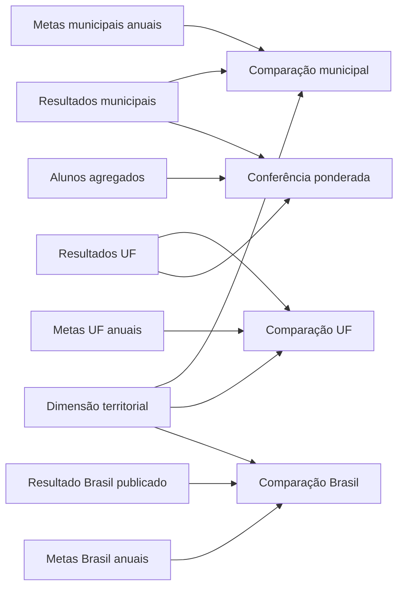

# Desenho proposto da base analítica

Proposta de 21/10/2026. **Somente modelagem e investigação; nenhuma das tabelas
propostas abaixo foi criada.** Os nomes são sugestões para discussão.

## Objetivo

Responder, para cada território e recorte compatível: qual o resultado observado,
qual a meta pactuada do mesmo ano, qual o saldo em pontos percentuais e qual a
situação da comparação. Acrescentar separadamente a distância até a meta de 2030.

Município, UF e Brasil são níveis diferentes de análise. A hierarquia territorial
permite navegar entre eles, mas não torna as suas metas intercambiáveis.

## Descobertas adicionais que afetam o desenho

Consulta de leitura às tabelas `meta_alfabetizacao_uf` e
`meta_alfabetizacao_brasil`:

- Rede textual `Pública` em ambas.
- Anos 2023, 2024 e 2025. Brasil tem uma linha por ano; UF tem 27 por ano.
- As chaves `(território, ano, rede)` dessas duas fontes não têm repetições
  na consulta realizada.
- Em 2024, os 25 resultados de `uf`, filtrados por série 2 e rede 5, são iguais
  aos valores da tabela de metas para as UFs correspondentes.
- DF e RR não têm registro nesse recorte de `uf`. A tabela de metas contém linha
  para ambos: resultado de DF de 59,13%, resultado de RR nulo e meta 2024 nula
  para ambos. AC tem resultado 51,38%, mas também não tem meta 2024.
- O resultado nacional de 2024 na tabela de metas é 59,2%, com meta 59,9%.
- Em MG, resultado público de 2024 de 72,07% e meta de 63,2%.
- A meta nacional de 2024 aparece como 59,9 nas linhas de 2023 e 2024, mas 60,0
  na linha de 2025. Em MG, a meta de 2024 aparece como 63,2 nas linhas de 2023 e
  2024 e 63,0 na de 2025. A origem dessa diferença de precisão/revisão ainda não
  foi determinada. Não tratá-la automaticamente como simples arredondamento.

Os campos `ano` identificam o contexto do resultado na fonte. Eles não provam
a data de publicação ou uma versão formal da meta. As linhas precisam permanecer
rastreáveis e não devem ser deduplicadas só por território e ano-alvo.

## Organização das tabelas

### 1. Dimensão territorial

`dim_territorio`: identifica cada município, UF e Brasil, com seu nível e seu pai.

| Campo | Significado |
| --- | --- |
| `nivel_territorial` | MUNICIPIO, UF ou BRASIL |
| `id_territorio` | Código municipal, sigla UF ou BR, conforme o nível |
| `nome_territorio` | Nome oficial |
| `id_territorio_pai` | Município aponta para UF; UF aponta para BR |
| `fonte_territorial` | Cadastro oficial utilizado |

Chave: `(nivel_territorial, id_territorio)`. Usar uma dimensão municipal oficial
para nomes e relacionamento com UF. Essa fonte auxiliar ainda deve ser selecionada
e validada. Não depender apenas de um prefixo de código como cadastro de referência.

### 2. Resultados em seus níveis originais

| Tabela proposta | Uma linha representa | Fonte inicial |
| --- | --- | --- |
| `resultados_municipais` | Município, ano, série e rede | `municipio` |
| `resultados_uf` | UF, ano, série e rede | `uf` |
| `resultados_brasil` | Brasil, ano e universo avaliado | Resultado contido em `meta_alfabetizacao_brasil` |

Campos comuns: território, ano do resultado, série/escopo, rede, percentual de
alfabetização, origem e identificação da cópia consultada. Os percentuais ficam
na escala 0 a 100, com a unidade documentada. Resultado nulo permanece nulo.

As taxas já presentes nas tabelas de metas de UF/município são preservadas como
resultados da publicação para comparação com a fonte agregada. Não produzir
duas linhas analíticas para o mesmo recorte só porque existem dois resultados de
origens diferentes. Guardar os dois valores na conferência e explicitar a fonte
selecionada na saída.

Para começar, o recorte de referência será 2024. A existência de resultados de
2025 nas publicações de metas não preenche automaticamente o histórico ausente
nas tabelas agregadas de município e UF. A incorporação posterior desses resultados
precisa de regra explícita, sem misturar anos na mesma comparação.

### 3. Metas anuais consolidadas

`metas_anuais`: estrutura comum para as três fontes de metas. Cada linha descreve
uma meta para um ano-alvo e território, dentro de um contexto de origem.

| Campo | Exemplo/uso |
| --- | --- |
| `nivel_territorial`, `id_territorio` | MUNICIPIO/3106200, UF/MG, BRASIL/BR |
| `rede_original`, `rede_normalizada` | Preservar texto/código e seu significado |
| `escopo_avaliacao` | 2º ano; preservar a origem dessa definição |
| `ano_referencia_fonte` | Campo `ano` da linha original |
| `ano_meta` | 2024, 2025, ..., 2030 |
| `meta_percentual` | Valor pactuado ou nulo |
| `id_snapshot_fonte` | Identifica uma extração preservada |
| `tabela_origem` | Uma das três tabelas de metas |
| `registro_meta_existe` | Distingue linha existente de ausência de correspondência |

Transformar as sete colunas de metas em linhas. **Preservar também as metas nulas**:
um UNPIVOT que exclua nulos apagaria a distinção entre meta vazia e registro ausente.

Chave proposta dentro de uma cópia da fonte: `(nível, território, rede, escopo,
ano_referencia_fonte, ano_meta, id_snapshot_fonte)`. Data de extração não deve ser
apresentada como data de publicação. Guardar versão/data oficial quando a fonte
efetivamente a fornecer.

Para o relatório de 2024, selecionar explicitamente as linhas de referência 2024
e a cópia de fonte usada na análise. Não escolher `MAX(ano)` e não aplicar
`DISTINCT` para resolver valores divergentes de metas históricas.

### 4. Agregados de alunos e conferência

`conferencia_microdados`: uma linha por ano, território, série e rede comparada,
com número de avaliados, soma dos pesos, taxa ponderada recalculada, taxa da fonte,
diferença e status da conferência.

Essa tabela dará uso analítico aos alunos e ajudará a avaliar a qualidade dos
resultados. A elegibilidade dos alunos (presença, preenchimento, proficiência,
alfabetizado e peso) ainda precisa ser investigada antes de escrever a fórmula
definitiva. Número total de registros não pode virar denominador da taxa.

Não transportar identificação de alunos para a Gold de comparação territorial.
Agregações e percentuais só serão confrontados em universos compatíveis.

## Junções e três saídas Gold propostas

O diagrama representa o desenho proposto, não uma arquitetura já executada.

### Comparação municipal

`gold_comparacao_municipal`: resultado municipal de série 2 e rede Municipal,
com meta municipal do mesmo ano. Junção de meta por território, escopo e rede
compatíveis, `ano_meta = ano_resultado` e contexto da fonte escolhido. Anexar
separadamente a meta municipal de 2030 do mesmo contexto.

### Comparação UF

`gold_comparacao_uf`: resultado de UF de série 2 no universo Público compatível,
com meta pública da própria UF. O mapeamento de `Pública` para o recorte rede 5
(estadual e municipal) é candidato, apoiado nos 25 resultados coincidentes de 2024.
**Coincidência numérica não prova sozinha o universo**: conferir o documento/dicionário
da publicação antes de aprovar esse mapeamento como regra definitiva. Não mapear
automaticamente para rede 6, que também inclui federal.

Usar o cadastro de UFs como base para tornar ausências visíveis. Em 2024, DF e RR
ficariam identificados como sem resultado na tabela `uf` para o recorte; o resultado
publicado de DF pode aparecer em coluna própria com sua fonte, sem preenchimento
silencioso do resultado principal. AC, DF e RR têm meta 2024 ausente na publicação.

### Comparação Brasil

`gold_comparacao_brasil`: resultado nacional publicado e meta nacional do mesmo
ano, rede/escopo e contexto de fonte. O resultado nacional já consta em
`meta_alfabetizacao_brasil`. Usá-lo como referência publicada, sem reconstruí-lo
por média simples de municípios ou UFs.

### Campos analíticos comuns

- `resultado_percentual`, `meta_do_ano_percentual` e fontes correspondentes.
- `saldo_meta_pp = resultado - meta_do_ano` (positivo indica superação).
- `meta_2030_percentual` e `distancia_2030_pp = meta_2030 - resultado`.
  Distância negativa indica que o valor pactuado já foi superado; não truncar sem
  explicar. Qualquer componente nulo mantém o cálculo indisponível.
- `tem_registro_resultado`, `tem_registro_meta`, `tem_valor_resultado`,
  `tem_valor_meta`: sinalizações independentes para preservar ausências simultâneas.
- `status_comparacao`: atingiu, não atingiu ou comparação indisponível.
- `motivo_indisponibilidade`: razões de resultado/meta ausentes, sem apagar as
  sinalizações. Preservar os rótulos detalhados da investigação municipal.
- `status_divulgacao_resultado`: divulgado na publicação de metas, ausente nela,
  ou ainda não conferido. Não chamar automaticamente todo valor numérico de
  resultado elegível para acompanhamento oficial.
- Ano, rede, série/escopo, contexto da meta, identificação das fontes e origem
  oficial/simulada. Os eventos simulados ainda não foram desenhados ou produzidos.

## Como mostrar os três níveis juntos

Uma tela pode exibir o município e, ao lado, o contexto de sua UF e do Brasil.
As comparações continuam independentes. Se houver uma visão municipal com colunas
de contexto, os campos devem dizer explicitamente `resultado_uf_rede_publica`,
`meta_uf_rede_publica`, `resultado_brasil_rede_publica` etc.

Não chamar a meta pública de MG de meta municipal de Belo Horizonte. Não usar a
meta estadual/nacional para preencher uma meta municipal vazia. Se indicadores
de contexto forem repetidos em cada município, não somá-los ou tirar sua média
para reconstruir um indicador estadual/nacional. As tabelas agregadas são a
referência para esses níveis.

Exemplo de navegação em 2024, preservando cada universo:

| Nível | Rede | Resultado | Meta do ano | Saldo |
| --- | --- | ---: | ---: | ---: |
| Belo Horizonte | Municipal | 68,58% | 61,33% | +7,25 p.p. |
| MG | Pública (mapeamento a validar documentalmente) | 72,07% | 63,20% | +8,87 p.p. |
| Brasil | Pública | 59,20% | 59,90% | -0,70 p.p. |

Esses saldos comparam cada território à própria meta; não demonstram efeito causal
do município sobre o estado ou sobre o país.

## Regras para aprovar o contrato

1. Chaves únicas antes e depois de cada junção, sem multiplicação de linhas.
2. Correspondência territorial medida; dimensão auxiliar sem pares deve gerar erro
   ou pendência explícita conforme o contrato, não exclusão silenciosa.
3. Mapeamento de rede documentado; código desconhecido não vira categoria válida.
4. Ano-alvo da meta igual ao ano do resultado na comparação anual.
5. Uma única linha de meta por chave analítica após selecionar o contexto da fonte.
   Valores conflitantes exigem decisão, não `MAX(meta)` arbitrário.
6. Correspondência da chave e preenchimento do valor medidos separadamente.
7. Ausências conhecidas preservadas, incluindo os 216 municípios investigados e
   lacunas estaduais; limites de qualidade justificados e ainda a definir.
8. Percentuais, unidades, divulgação e denominadores documentados.
9. Cenário aspiracional de 100% separado da meta pactuada de 2030 na fonte (80%).
10. Não usar saldo/meta atingida como feature para prever o próprio resultado do
    mesmo ano. Features e dados disponíveis no momento da previsão serão definidos
    separadamente para fase 3.

## Decisões ainda abertas

- Aprovar o mapeamento exato da rede Pública da publicação.
- Selecionar e conferir o cadastro territorial oficial.
- Definir a política de fonte principal e alternativa, divulgação e contexto de metas.
- Investigar regras de elegibilidade e pesos dos alunos.
- Aprovar limites bloqueantes e informativos a partir das lacunas registradas.

Depois dessas decisões, desenhar o fluxo de ingestão e a arquitetura de execução.
Até lá, os artefatos produzidos são documentação e consultas de pesquisa.
